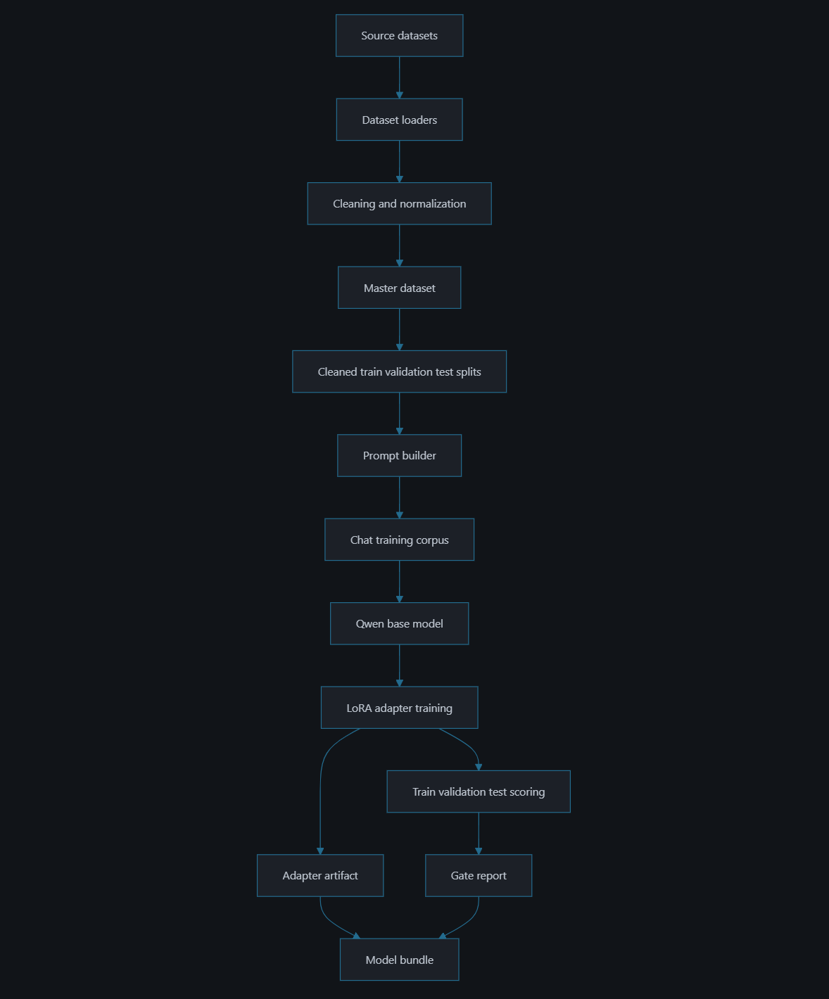
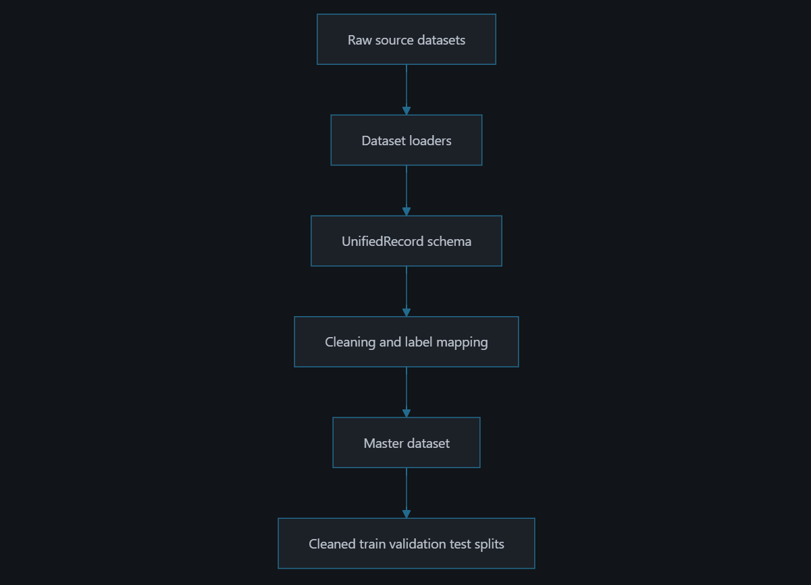

# FakeNews Qwen LoRA Adapter

This repository contains a PEFT/LoRA adapter for `Qwen/Qwen2.5-1.5B-Instruct` trained by the FakeNews research pipeline. The model is intended to study whether an open-source instruction model can classify misinformation when given different amounts and qualities of source context.

This artifact is an adapter, not a standalone full model. Load it with the base model listed above.

## Model Details

### Model Description

- **Developed by:** Jay Bell Compaan
- **Funded by:** Kingston University
- **Shared by:** Jay Bell Compaan
- **Model type:** PEFT LoRA adapter for causal language modeling
- **Base model:** `Qwen/Qwen2.5-1.5B-Instruct`
- **Language(s) (NLP):** The base model is multilingual; this adapter was trained on mixed-source misinformation datasets with English and non-English records represented in the source corpora.
- **License:** MIT
- **Finetuned from model:** `Qwen/Qwen2.5-1.5B-Instruct`
- **Training context mode:** `full`
- **Context budget:** `1.0`
- **Gate policy:** `report`
- **Release ready:** `false`
- **Artifact ready:** `true`

The adapter was trained to produce a compact JSON response for binary misinformation classification (`real` or `fake`) plus confidence, explanation, reasoning signals, and whether external evidence is required.

### Model Sources

- **Repository:** [FakeNews](https://github.com/JayNightmare/FakeNews)
- **Base model:** [Qwen/Qwen2.5-1.5B-Instruct](https://huggingface.co/Qwen/Qwen2.5-1.5B-Instruct)
- **Paper:** Currently being drafted for submission to a peer-reviewed conference.
- **Demo:** TBD

## Uses

Use this model for research experiments on misinformation classification and context ablation. It is suitable for comparing model behavior across context conditions such as full context, minimal context, or intentionally misleading context when the broader FakeNews pipeline is used.

The model should not be used as a final authority for fact checking, moderation, legal decisions, medical decisions, election operations, or other high-stakes determinations. Its outputs should be treated as experimental model predictions requiring human review and external evidence.

### Direct Use

Direct use means loading the Qwen base model with this adapter and prompting it to classify a claim or source excerpt. The intended direct use is exploratory research: inspect whether the adapter returns the expected JSON schema and compare its behavior across carefully controlled prompts.

Expected output shape:

```json
{
  "classification": "fake",
  "confidence": 0.66,
  "explanation": "Short explanation based on the provided claim and context.",
  "reasoning_signals": ["dataset: ClaimReview", "context text available"],
  "requires_external_evidence": false
}
```

Generated JSON should be parsed and validated by downstream code before use.

### Downstream Use

Downstream use is expected through the FakeNews experimental pipeline, where the same records can be evaluated under `full`, `minimal`, and `misleading` context conditions. The adapter can also be used as one point in a multi-model comparison, provided each base model receives its own separately trained adapter.

Example downstream tasks:

- Measuring performance shifts as context is reduced.
- Comparing text-only and image-text-capable base models.
- Producing validation/test reports for research artifacts.
- Studying whether model explanations change with misleading or incomplete context.

### Out-of-Scope Use

This model is out of scope for:

- Automated content moderation or user enforcement.
- Determining whether a person, organization, publication, or community is trustworthy.
- Election, legal, medical, financial, or safety-critical decisions.
- Real-time misinformation policing without human fact-checking.
- Claims requiring fresh web evidence, private data, or source verification not present in the prompt.
- Applying this adapter to unrelated base models. LoRA adapters are not generally portable across arbitrary model architectures.

## Bias, Risks, and Limitations

- This is a research artifact, not a production fact-checking system.
- The adapter was trained in `full` context mode for this run. Minimal and misleading context comparisons require separate evaluation runs or additional adapters.
- The model may learn dataset-specific artifacts, publisher patterns, wording conventions, class imbalance, or label mapping decisions rather than robust factual verification.
- ClaimReview dominates the sampled gate evaluations, so aggregate metrics may hide weaker performance on smaller datasets.
- Confidence values are generated by the target response format and should not be treated as calibrated probabilities.
- The artifact is text-only. The wider FakeNews codebase supports image-aware Hugging Face inference for compatible vision-language models, but this adapter was not trained with image tensors.
- The run is not release ready under the configured diagnostic gate because `test_confidence_mean` fell below the threshold.

### Recommendations

Users should:

- Treat outputs as hypotheses for research review, not verified facts.
- Keep human review and source evidence in the loop.
- Report metrics by dataset and context mode rather than relying only on aggregate accuracy.
- Validate output JSON before consuming predictions.
- Re-run evaluation when changing context mode, base model, sampling, or prompt format.
- Train one adapter per base model instead of reusing this adapter across unrelated model families.

## How to Get Started with the Model

Install compatible dependencies, then load the base model and adapter:

```python
from peft import PeftModel
from transformers import AutoModelForCausalLM, AutoTokenizer

base_model_id = "Qwen/Qwen2.5-1.5B-Instruct"
repo_id = "JayNightmare/FakeNews"

tokenizer = AutoTokenizer.from_pretrained(base_model_id)
model = AutoModelForCausalLM.from_pretrained(base_model_id)
model = PeftModel.from_pretrained(model, repo_id, subfolder="adapter")

prompt = """Return JSON only.

Classify this claim as real or fake and explain briefly:
Claim: The moon is made of cheese.
Context: This is a known humorous false claim, not a factual astronomy statement.
"""

inputs = tokenizer(prompt, return_tensors="pt")
outputs = model.generate(**inputs, max_new_tokens=160)
print(tokenizer.decode(outputs[0], skip_special_tokens=True))
```

For local bundle use from the generated model bundle directory, replace the final load line with `PeftModel.from_pretrained(model, "adapter")`.

## Training Details

### Pipeline Overview



### Training Data

The adapter was trained on cleaned splits from the FakeNews master dataset. The combined corpus includes records from:

- ClaimReview
- FakeNewsNet
- Fakeddit
- MuMiN

Training split sizes:

| Split | Records |
| --- | ---: |
| Train | 252,243 |
| Validation/eval corpus | 54,052 |
| Test | 54,053 |

The run used explicit cleaned split directories:

- `src/datasets/data/cleaned/train`
- `src/datasets/data/cleaned/validation`
- `src/datasets/data/cleaned/test`

Google Fact Check grounding was disabled for this run.

### Training Procedure

#### Preprocessing

Source-specific dataset loaders convert records into a canonical `UnifiedRecord` schema. The cleaning pipeline removes empty or very short records, normalizes whitespace, preserves provenance metadata, maps source labels to internal `real`/`fake` labels, and exports deterministic cleaned train/validation/test splits.

Each training record is rendered with the FakeNews prompt builder using `context_mode=full` and `context_budget=1.0`. The target assistant message is deterministic JSON supervision containing classification, confidence, explanation, reasoning signals, and whether external evidence is required.



#### Training Hyperparameters

| Hyperparameter | Value |
| --- | --- |
| Training regime | CUDA training; exact floating-point dtype was not recorded in the artifact summary |
| Epochs | 1 |
| Per-device train batch size | 1 |
| Per-device eval batch size | 1 |
| Gradient accumulation steps | 8 |
| LoRA rank | 16 |
| LoRA alpha | 32 |
| LoRA dropout | 0.05 |
| LoRA bias | none |
| Task type | `CAUSAL_LM` |
| Target modules | `q_proj`, `k_proj`, `v_proj`, `o_proj`, `up_proj`, `down_proj`, `gate_proj` |

#### Speeds, Sizes, Times

| Measurement | Value |
| --- | ---: |
| Train forward steps | 252,243 |
| Train optimization steps | 31,531 |
| Eval batches | 54,052 |
| Train loss | 0.004119 |
| Eval loss | 0.003399 |
| Eval perplexity | 1.003405 |

Wall-clock training time was not recorded in the artifact metadata.

## Evaluation

### Testing Data, Factors & Metrics

#### Testing Data

Validation and test scoring used deterministic subsets of up to 1,000 records from the cleaned validation and test splits. The full cleaned split sizes were 54,052 validation records and 54,053 test records.

#### Factors

Evaluation reports disaggregate by:

- Dataset: ClaimReview, FakeNewsNet, Fakeddit, MuMiN.
- Context mode: `full` for this run.
- Dataset plus context mode.
- Label distribution and confusion matrix.

#### Metrics

Metrics include accuracy, precision, recall, F1, confusion matrix counts, support, confidence statistics, explanation counts, and release-gate diagnostics. These metrics are research diagnostics, not production certification.

### Results

| Split | Accuracy | Precision | Recall | F1 | Support |
| --- | ---: | ---: | ---: | ---: | ---: |
| Validation | 0.9050 | 0.9597 | 0.9203 | 0.9396 | 1,000 |
| Test | 0.9020 | 0.9441 | 0.9322 | 0.9381 | 1,000 |

Confidence statistics:

| Split | Mean | Min | Max |
| --- | ---: | ---: | ---: |
| Validation | 0.6668 | 0.66 | 0.69 |
| Test | 0.6667 | 0.66 | 0.69 |

Test-set metrics by dataset:

| Dataset | Accuracy | Precision | Recall | F1 | Support |
| --- | ---: | ---: | ---: | ---: | ---: |
| ClaimReview | 0.9297 | 0.9619 | 0.9633 | 0.9626 | 725 |
| Fakeddit | 0.8036 | 0.8105 | 0.7476 | 0.7778 | 224 |
| FakeNewsNet | 0.9375 | 1.0000 | 0.6667 | 0.8000 | 48 |
| MuMiN | 1.0000 | 1.0000 | 1.0000 | 1.0000 | 3 |

#### Summary

The adapter passed the configured accuracy, F1, train/validation F1-gap, validation/train loss-ratio, and underfit-loss checks. It did not pass the `test_confidence_mean >= 0.70` check (`actual = 0.6667`). Because the run used `gate_policy=report`, the artifact was still generated for research comparison, but `release_ready=false`.

## Model Examination

No separate interpretability or mechanistic analysis was performed for this artifact. Evaluation currently relies on aggregate and disaggregated classification metrics plus sampled generated explanations. Future examination should inspect failure cases by dataset, source publisher, context condition, and label class.

## Environmental Impact

Carbon emissions were not measured for this run. The artifact metadata records CUDA training but does not record the exact GPU model, provider, region, power draw, or wall-clock duration.

- **Hardware Type:** CUDA GPU, exact model not recorded
- **Hours used:** Not recorded
- **Cloud Provider:** Not recorded
- **Compute Region:** Not recorded
- **Carbon Emitted:** Not measured

Carbon emissions can be estimated using the [Machine Learning Impact calculator](https://mlco2.github.io/impact#compute) presented in [Lacoste et al. (2019)](https://arxiv.org/abs/1910.09700) if hardware, runtime, and region are known.

## Technical Specifications

### Model Architecture and Objective

The base architecture is `Qwen/Qwen2.5-1.5B-Instruct`, adapted with PEFT LoRA modules for causal language modeling. The adapter objective is supervised instruction tuning: given a misinformation classification prompt, generate JSON with a binary label and short explanatory fields.

LoRA configuration:

| Setting | Value |
| --- | --- |
| PEFT type | `LORA` |
| PEFT version | `0.19.1` |
| Task type | `CAUSAL_LM` |
| Rank (`r`) | 16 |
| Alpha | 32 |
| Dropout | 0.05 |
| Bias | `none` |
| Inference mode | `true` |
| Adapter weights | `adapter_model.safetensors` |

### Compute Infrastructure

The training script used the repository's manual Hugging Face adapter trainer at `src/train_hf_adapter.py`. It loads the base model, attaches LoRA modules with PEFT, tokenizes supervised chat examples, trains for one epoch, evaluates on the explicit validation split, then scores deterministic gate subsets from train/validation/test.

#### Hardware

- CUDA device was used.
  - RTX 5070 Laptop GPU
- RAM: 32 GB
- CPU: Intel(R) Core(TM) 9 270H
- Disk: 1 TB SSD
- OS: Windows 11 Edu

#### Software

- PEFT 0.19.1
- Transformers-compatible causal language model loading via `AutoModelForCausalLM`
- Hugging Face tokenizer and chat template assets included in the adapter directory
- FakeNews research pipeline from [JayNightmare/FakeNews](https://github.com/JayNightmare/FakeNews)

## Citation

The paper is currently being drafted for submission to a peer-reviewed conference.

**BibTeX:**

```bibtex
@misc{compaan_fakenews_qwen_adapter_2026,
  title = {FakeNews Qwen LoRA Adapter for Context-Aware Misinformation Classification},
  author = {Compaan, Jay Bell and Peiling, Yi and Charles, Michael J. C.},
  year = {2026},
  note = {Research artifact; paper in preparation}
}
```

**APA:**

Compaan, J. B., Peiling, Y., & Charles, M. J. C. (2026). *FakeNews Qwen LoRA Adapter for Context-Aware Misinformation Classification*. Research artifact; paper in preparation.

## Glossary

- **Adapter:** A small set of learned parameters loaded on top of a base model.
- **LoRA:** Low-Rank Adaptation, a parameter-efficient fine-tuning method.
- **Context budget:** Fraction of available contextual information retained in prompts.
- **Context ablation:** Evaluation that varies available context to measure prediction changes.
- **Gate policy:** Repository setting that determines whether validation/test checks only report metrics or block artifact generation.
- **Release ready:** Whether all configured diagnostic gate checks passed.
- **Artifact ready:** Whether the adapter artifact was generated for research use.

## More Information

- Project repository: [JayNightmare/FakeNews](https://github.com/JayNightmare/FakeNews)
- Base model: [Qwen/Qwen2.5-1.5B-Instruct](https://huggingface.co/Qwen/Qwen2.5-1.5B-Instruct)
- Primary run artifacts: `artifacts/training/qwen_release/`
- Bundle manifest: `artifacts/FakeNews_Model/bundle_manifest.json`

## Model Card Authors

- Dr. Yi Peiling - Kingston University, UK
- Jay Bell Compaan (JayNightmare) - Kingston University, UK
- Michael JC Charles - Kingston University, UK

## Model Card Contact

For questions or comments about this model, please contact Dr. Yi Peiling at <yi.peiling@kingston.ac.uk>.

### Framework versions

- PEFT 0.19.1
